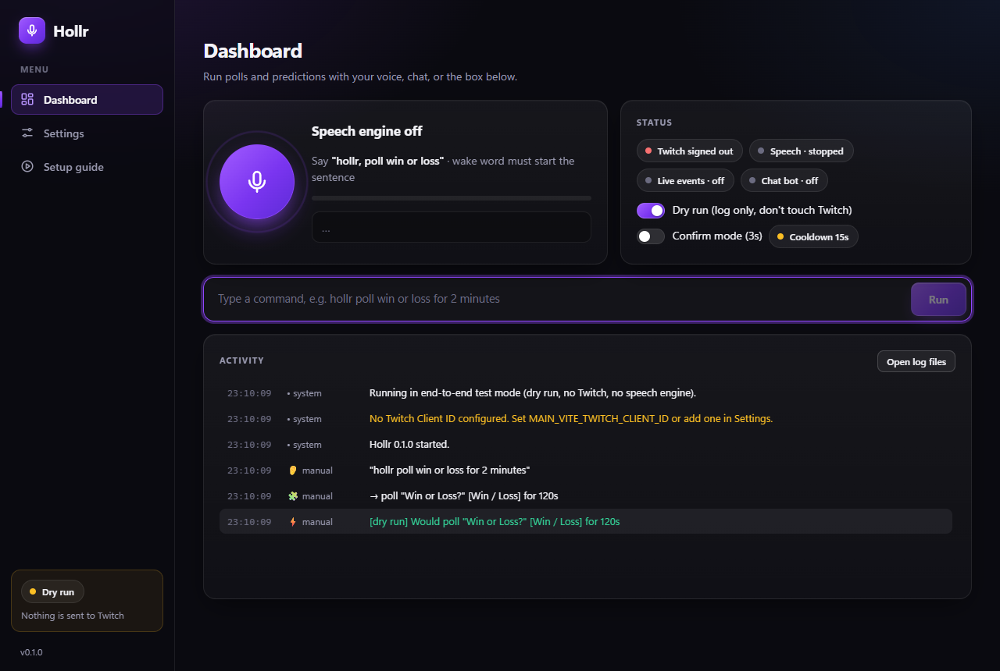
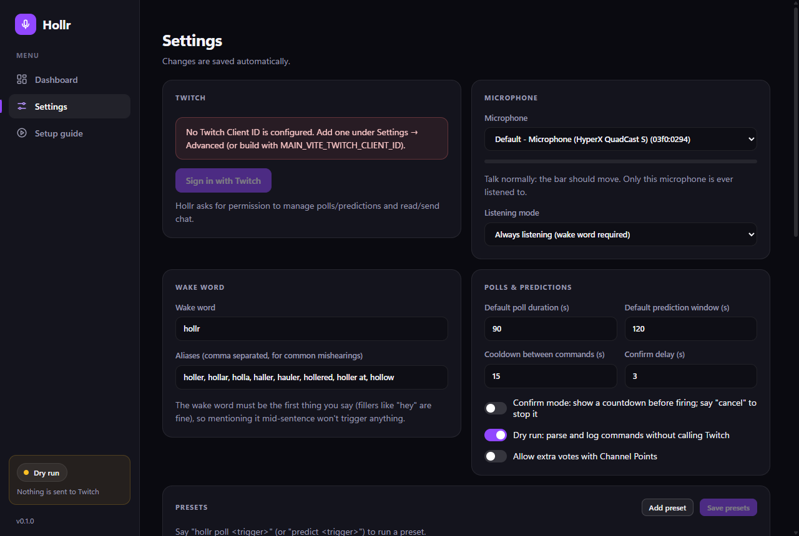
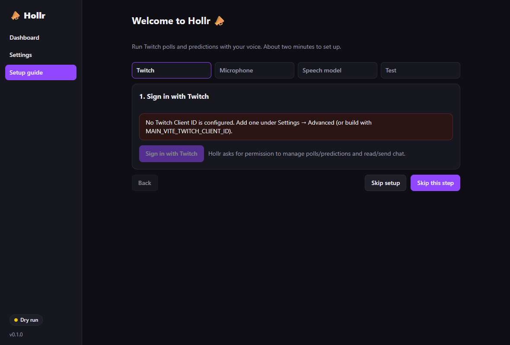

# Hollr

Voice-controlled Twitch polls and predictions. Say **"Hollr, poll win or loss for 2 minutes"** and Hollr creates it on your channel. Mods can do the same from chat with `!hollr poll a or b`.

Built with Electron, Angular, and on-device speech recognition ([sherpa-onnx](https://github.com/k2-fsa/sherpa-onnx)). Audio never leaves your machine.

## Screenshots

**Dashboard** – live status, command box, and activity log (shown in dry-run mode)



**Settings** – wake word, microphone, presets, hotkeys, chat bot, overlay



**Setup guide** – Twitch sign-in, microphone, speech model, and a test run



## Features

- **Voice commands** with a wake word (`hollr`, plus aliases for common mishearings). Streaming Zipformer model by default; optional Whisper.
- **Polls and predictions**: create, end, cancel, lock, resolve, repeat, plus saved presets ("Hollr, poll match").
- **Chat bot** (EventSub chat): the broadcaster and, optionally, mods/VIPs can use `!hollr …`. The bot announces poll and prediction starts and results.
- **Safety rails**: cooldown, one active poll/prediction at a time, optional confirm countdown with cancel, and a dry-run mode that logs without calling Twitch.
- **Hotkeys**, push-to-talk, tray icon, start-with-system, and auto-update (GitHub Releases).
- **OBS overlay** at `http://127.0.0.1:4747/overlay` (browser source).
- **Secure by default**: public Twitch client (no secret shipped), tokens encrypted with Electron `safeStorage`, context isolation and sandbox on.

## Getting started

Requirements: Node 22.12+ and Windows (macOS builds are configured but untested).

```bash
npm install
cp .env.example .env     # then set MAIN_VITE_TWITCH_CLIENT_ID
npm run dev
```

### Twitch setup

1. On the [Twitch developer console](https://dev.twitch.tv/console), register an application with Client Type **Public**. Device Code Grant Flow requires no client secret.
2. Put the Client ID in `.env` as `MAIN_VITE_TWITCH_CLIENT_ID`, or paste it under Settings → Advanced.
3. Sign in from the app. Polls and predictions need an Affiliate or Partner channel.

### Speech model

The model is downloaded and SHA-256 verified during the setup guide. For development, it is stored in `%APPDATA%/Hollr/models`.

## Commands

| Command | Purpose |
| --- | --- |
| `npm run dev` | Angular dev server + electron-vite + STT worker watch |
| `npm run build` | Build renderer, main, preload, and STT worker |
| `npm start` | Run the built app |
| `npm test` | Unit tests (Vitest) |
| `npm run test:clips` / `npm run test:stt` | Generate TTS clips and run the speech harness |
| `npm run test:e2e` | Build and run the Playwright Electron smoke test |
| `npm run typecheck` / `npm run lint` | Static checks |
| `npm run dist` | Package the Windows EXE and MSI locally |
| `npm run dist:mac` / `npm run dist:linux` | Package a macOS DMG or Linux AppImage and deb locally |

## Voice grammar (examples)

- `hollr poll cats or dogs for two minutes`
- `hollr predict win or loss`
- `hollr end poll` / `hollr cancel poll` / `hollr lock prediction`
- `hollr poll match` (runs the preset named "match")

The full grammar lives in `src/main/commands/grammar.ts` and is covered by `tests/unit/grammar.test.ts`.

## Project layout

```
src/main       Electron main process: auth, Twitch API, EventSub, chat bot, command router, STT controller, overlay
src/main/stt   Speech engines and the utilityProcess worker (built separately to out/worker)
src/preload    contextBridge API
src/renderer   Angular UI (zoneless, signals)
src/shared     Types, IPC contracts, defaults
tests          Unit, STT harness, and e2e tests
```

See [PLAN.md](PLAN.md) for the original design.

## Releases

GitHub Actions builds installers when you push a tag that matches `package.json`, for example `v0.1.0`, or when you run the **Release** workflow by hand. Assets land on [GitHub Releases](https://github.com/JaredScar/TwitchHollr/releases):

| Platform | Files |
| --- | --- |
| Windows x64 | `Hollr-Setup-<version>.exe` (NSIS) and `Hollr-Setup-<version>.msi` |
| macOS | `Hollr-<version>-arm64.dmg` and `Hollr-<version>-x64.dmg` (a `.zip` is also attached for auto-update) |
| Linux x64 | `Hollr-<version>-x64.AppImage` and a `.deb` |

The installers are unsigned, so Windows SmartScreen and macOS Gatekeeper warn on first launch until a code-signing certificate is added to the repository secrets. The packaged app checks this repository for updates.

```bash
git tag v0.1.0
git push origin v0.1.0
```

## License

[MIT](LICENSE). Use it, change it, and share it freely. Twitch Client IDs and tokens stay on your machine: copy `.env.example` to `.env` and never commit `.env`.
